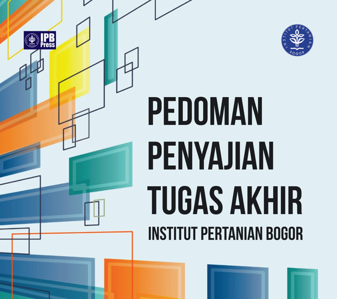
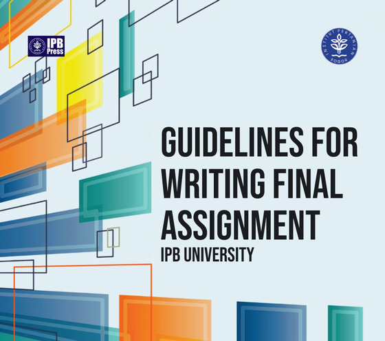
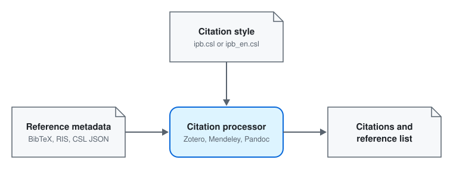

# IPB PPTA Citation Styles

**IPB** = *Institut Pertanian Bogor* / *IPB University* / *Bogor Agricultural University*<br>
**PPTA** = *Pedoman Penyajian Tugas Akhir* (Bahasa Indonesia) / *Guidelines for Writing Final Assignment* (English)

<table>
  <tr>
    <td align="center">
      <a href="https://dtptp.ipb.ac.id/ppta-ipb/"></a><br>
      <sub><b>Bahasa Indonesia</b>: use <code>ipb.csl</code></sub>
    </td>
    <td align="center">
      <a href="https://dtptp.ipb.ac.id/ppta-english/"></a><br>
      <sub><b>English</b>: use <code>ipb_en.csl</code></sub>
    </td>
  </tr>
</table>

**Citation styles for IPB University theses, in Bahasa Indonesia and English.**

[Citation Style Language](https://citationstyles.org/) (CSL) styles that format citations and reference lists the way
IPB's thesis guide, *Pedoman Penyajian Tugas Akhir* (PPTA, 2026), asks for. They work in Zotero, Mendeley, Pandoc,
R Markdown and Quarto.


> [!NOTE]
> This is a fork of [auriza/csl-ipb-ppki](https://github.com/auriza/csl-ipb-ppki), the original IPB style by Auriza
> Rahmad Akbar and M. Rachmatarramadhan for the earlier guide, PPKI 4. This fork adds the **English style**,
> `ipb_en.csl`, and updates both styles to PPTA. Download both from here. It is an independent project, not an
> official IPB publication; the guide covers above link to IPB's own pages.

## Download

| Style | For | File |
|:--|:--|:--|
| **Bahasa Indonesia** | Theses and papers written in Indonesian | [`ipb.csl`](https://raw.githubusercontent.com/bennyistanto/csl-ipb/master/ipb.csl) |
| **English** | Theses and papers written in English, such as international programs and journal manuscripts | [`ipb_en.csl`](https://raw.githubusercontent.com/bennyistanto/csl-ipb/master/ipb_en.csl) |

Right-click a file and choose "Save link as". The two styles can be installed side by side.

## Quick start in Zotero

1. Download the style you need.
2. In Zotero 7, open **Edit > Settings > Cite**, click **+** under **Styles**, and select the file.
3. In Word, open **Document Preferences** in the Zotero toolbar and choose
   *Institut Pertanian Bogor: Pedoman Penyajian Tugas Akhir*.

For Mendeley, Pandoc, R Markdown and Quarto, see [Installation](docs/installation.md).

## What it looks like

```text
(Aulia et al. 2024)     (Rusmana dan Nedwell 2024)     (Rusmana and Nedwell 2024)

Aulia G, Rachman F, Untari F, Rasyid A, Hapsari Y. 2024. Utilizing the co-culture method to improve the
    investigation of secondary metabolites of marine bacteria. J Appl Pharm Sci. 14(1):286–290.
    doi:10.7324/JAPS.2024.136305.

Buchori D, Puspitasari S, Sahari B, Rizali A. 2017. Insect pollinators in decline: conservation challenges in the
    tropics. Di dalam: Aguirre AA, Sukumar R, editor. Tropical Conservation: Perspectives on Local and Global
    Priorities. Oxford University Press. hlm 290–300.

    ... In: Aguirre AA, Sukumar R, editor. ... Oxford University Press. p 290–300.     (English style)
```

<picture>
  <source media="(prefers-color-scheme: dark)" srcset="img/csl-flow-dark.svg">
  
</picture>

## Documentation

| Page | What is in it |
|:--|:--|
| [Installation](docs/installation.md) | Zotero, Mendeley Cite, Mendeley Desktop, Pandoc, R Markdown and Quarto |
| [Zotero guide](docs/zotero-guide.md) | Which field to fill for each source type, and what the style cannot fix for you |
| [Style notes](docs/style-notes.md) | How the two styles differ, what changed from PPKI 4, PPTA's own inconsistencies, and known issues |
| [Testing and examples](docs/testing.md) | The PPTA test library, two real papers, and how to check a change |

**The guides.** PPTA (2026, current): [Bahasa Indonesia](https://dtptp.ipb.ac.id/ppta-ipb/) |
[English](https://dtptp.ipb.ac.id/ppta-english/) | [Supplements](https://ipb.link/suplemen-ppta).
PPKI 4 (2019, previous): [Bahasa Indonesia](https://simak.ipb.ac.id/Foto/Panduan/Panduan_31.pdf) |
[English](https://kmm.ipb.ac.id/ppki-edisi4-eng/). Styles for PPKI 4 are listed under
[Guide versions](docs/style-notes.md#guide-versions).

## Credits and license

- `ipb.csl`: Auriza Rahmad Akbar and M. Rachmatarramadhan, revised for PPTA by Benny Istanto.
- `ipb_en.csl`: English translation by Benny Istanto, based on the
  [Institut Pertanian Bogor style](https://www.zotero.org/styles/institut-pertanian-bogor) in the Zotero Style
  Repository. The original list of translated terms is in
  [this gist](https://gist.github.com/bennyistanto/ef6b1a2bb1ed303a7832f789ac7e7a70).

Both styles are licensed under
[Creative Commons Attribution-ShareAlike 3.0](https://creativecommons.org/licenses/by-sa/3.0/). Issues and pull
requests are welcome.
